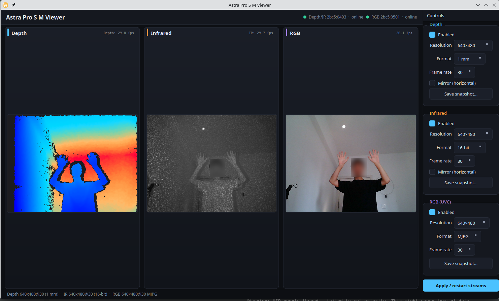

# AstraProSMViewer

Orbbec Astra Pro S M 上位机（Qt6 / C++17）。

- **Depth / IR**：通过 `orbbec-openni2`（OpenNI2 SDK）读取
- **RGB**：UVC 摄像头为独立 USB 设备（`2bc5:0501`），直接走 V4L2（OpenCV `VideoCapture`）采集，不经过 OpenNI2




## 功能

- Depth / IR / RGB 三路同显；Depth 用 turbo 伪彩 + 自动量程，IR 支持 8-bit / 16-bit
- 每路提供分辨率、像素格式、帧率三个下拉框，帧率选项随「分辨率 + 格式」联动刷新
- 模式来源：Depth / IR 取自 OpenNI2 `getSupportedVideoModes`；RGB 的分辨率与帧率取自 UVC 设备（`VIDIOC_ENUM_FMT / ENUM_FRAMESIZES / ENUM_FRAMEINTERVALS`），格式为 MJPG / YUYV（OpenCV 可解码为 RGB 的两种）
- RGB 固定使用机内 UVC 摄像头（`2bc5:0501`），按 VID:PID 自动定位，无设备选择
- 设置持久化：启动时恢复上次保存的值，点击「Apply / restart streams」后写入程序目录 `AstraProSMViewer.ini`
- Depth / IR 水平镜像
- 鼠标悬停深度图读取该点毫米距离
- 各路独立快照保存（PNG）
- 各路实时 FPS 显示

## 依赖（Arch Linux）

```
pacman -S orbbec-openni2 qt6-base opencv cmake
```

## 构建与运行

```
cmake -B build -DCMAKE_BUILD_TYPE=Release
cmake --build build
./build/AstraProSMViewer
```

## 踩坑记录（Orbbec OpenNI2 驱动特性）

1. **帧回调按 listener 指针注册**：同一个 `NewFrameListener` 对象注册到两路流时，后一次注册会顶掉前一次——depth + IR 必须各用一个独立 listener 对象（见 `OpenNICamera::FrameRelay`）。
2. **流必须先全部 create 再 start**：一路流 start 后再 create 另一路，会触发 MX400 内部传感器重建，静默杀死前一路的帧输出（见 `OpenNICamera::startStreams`）。
3. **本机内核 sysfs 无 `format` 文件**：区分 V4L2 采集节点与 metadata 节点用 `/sys/class/video4linux/videoN/index`（0 = 采集，1 = metadata），见 `RgbCamera::listDevices`。
4. 驱动广播的部分分辨率/格式组合无法启动（如 1280×720）；界面列出设备广播的全部组合，选中不可用组合时流启动失败、状态栏报错。
5. **镜像（Mirror）**：Depth / IR 均支持水平镜像，但驱动 `STREAM_PROPERTY_MIRRORING` 语义是反的——`setMirroringEnabled(false)` 才产生翻转（默认 `true`=不翻转），且该属性要在流 `start()` **之后**动态设置才生效（start 前设置会被忽略）。`OpenNICamera::applyMirroring()` 已做映射。
